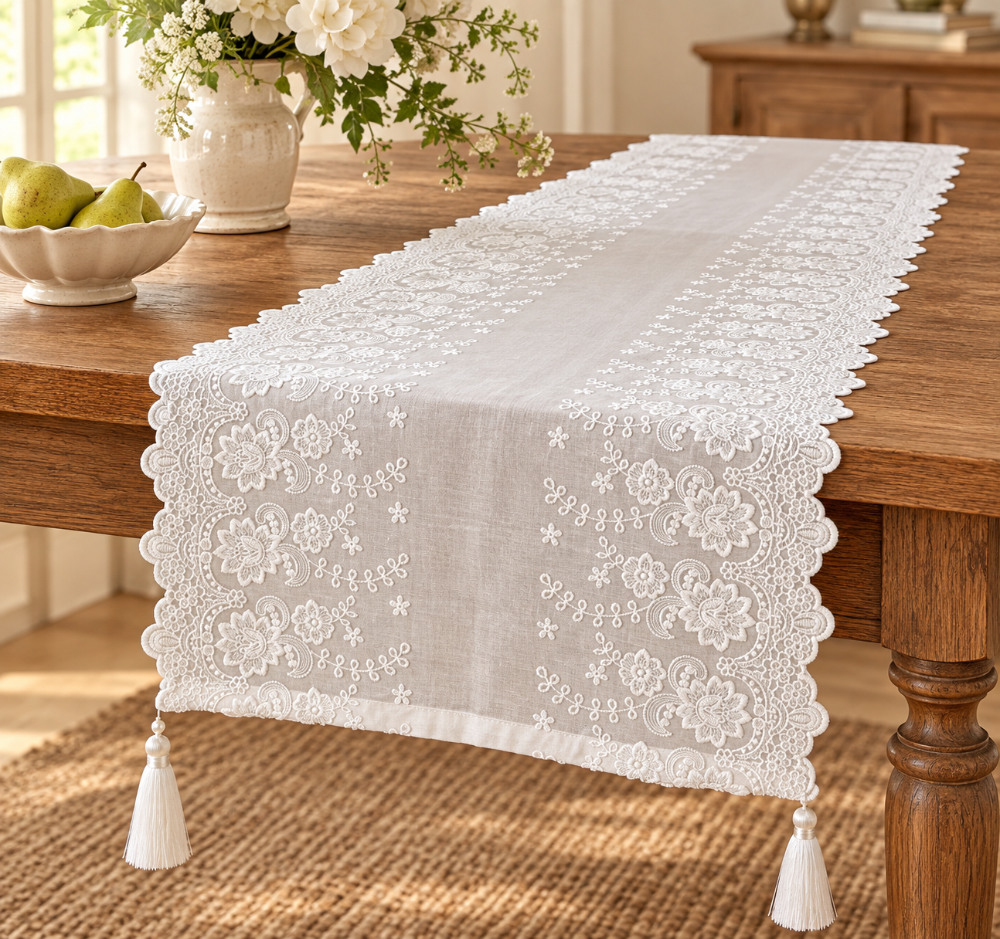

# 桌旗七图模板 · FrenchStyleDecor

版本：2026-09-30。此模板只适用于本款白色刺绣桌旗。它是“产品锁定模板”：先锁定实物的比例、轮廓、刺绣布局和流苏，再改变拍摄场景。之前生成的效果图不作为模板参考。

## 快速调用

“按 FrenchStyleDecor 的本款桌旗七图模板生成 7 张 1:1 产品图。使用 `products/table-runner-template/references/` 中的原始照片作为产品唯一事实来源。严格保持桌旗的长宽比例、中央素色区域、两侧花卉刺绣、波浪花边和两端流苏；只改变镜头角度、摆放方式和法式乡村场景。先生成无水印稿，审核通过后再添加 Fren.png 水印。”

## 已采用效果图示例



此图替换此前模板中的效果图，作为本款桌旗后续生成时的场景与呈现参考；产品本体仍以“原始参考”中的实拍图为唯一事实来源。

## 原始参考

- [完整垂挂参考](../products/table-runner-template/references/source-01-full-drape.png)
- [折叠参考](../products/table-runner-template/references/source-02-folded.png)
- [刺绣细节参考](../products/table-runner-template/references/source-03-embroidery-detail.png)
- [平铺参考](../products/table-runner-template/references/source-04-flat-on-table.png)
- [折叠斜角参考](../products/table-runner-template/references/source-05-folded-angle.png)
- [边缘与流苏参考](../products/table-runner-template/references/source-06-edge-detail.png)
- [正面平铺参考](../products/table-runner-template/references/source-07-front-flat.png)

原图中的中文版权文字和水印只属于参考照片，不得出现在生成成品中。

## 产品锁定规则

### 轮廓与比例

- 产品是狭长的矩形桌旗，长度明显大于宽度；不得生成方形、短胖比例或普通整桌桌布。
- 两端为直边，角部和长边带连续波浪形花边；两端各连接一个白色流苏。
- 流苏位于桌旗两端的左右角附近，数量为两枚；流苏为白色丝线，带小珠/包头结构。不得改为四枚、彩色流苏、穗边或无流苏。
- 桌旗可平铺、横跨桌面后自然垂下，或有少量折叠；不能凭空增加口袋、绑带、纽扣、拉链或夹子。

### 面料与刺绣布局

- 底布是白色至自然白色的轻薄、略透光织物；保留真实的细微褶皱和织物纹理。
- 中央是一条相对素净的纵向区域，只有少量分散的小花/小叶刺绣；不得填满中央或改成纯蕾丝网。
- 两侧是对称、连续、密集的白色花卉与叶蔓刺绣带，靠近长边的位置最密，向中央逐渐变疏。
- 刺绣包含大花、较小花朵、卷曲叶蔓、细小散点和镂空蕾丝边；必须保持原图的花形语言、方向、相对尺寸和重复节奏。
- 长边与端部均有连续波浪花边；不得替换成直线包边、宽荷叶边、流苏边或几何条纹。
- 颜色保持白色/自然白色，允许受环境光产生轻微暖色，但不得变成米黄、灰褐或纯白过曝。

### 真实性边界

- 不从照片推断具体材质成分、尺寸厘米、洗护方式、遮光性、防水性、手工/机器工艺或包装内容。
- 不把花瓶、花束、餐具和桌面当作产品组成部分；它们只是场景道具。
- 生成图不保留原图版权文字、水印、手机拍摄痕迹或背景杂物。

## 七张图：每张只回答一个购买问题

| 编号 | 用途 | 构图要求 | 必须检查 |
|---|---|---|---|
| 01 | 主图：完整使用效果 | 平视三分之四角度，桌旗横跨木质边柜或餐桌，一端自然垂下；尽量看到完整长度和两枚流苏 | 长宽比例、两侧刺绣带、中央素区、流苏数量 |
| 02 | 垂挂结构 | 低位侧前方，突出桌面到垂直落下的转折和波浪边 | 不得把桌旗变成桌布；边缘连续、流苏在端角 |
| 03 | 平铺整体 | 90° 顶视，桌旗完全展开在木桌或浅色布面上，完整轮廓入镜 | 中央素区宽度、两侧对称布局、两端流苏 |
| 04 | 刺绣细节 | 近距离微距，取一侧花卉刺绣与中央过渡区 | 花形、线迹、半透底布和镂空边缘真实 |
| 05 | 边缘与流苏细节 | 斜角近景，取一个波浪边端角和一枚流苏 | 波浪边、端部结构、珠头和丝线；不得重造流苏 |
| 06 | 餐桌生活方式 | 法式乡村餐桌，桌旗居中，少量餐具和花瓶；产品占主要视觉面积 | 道具不遮挡刺绣，桌旗仍是狭长矩形 |
| 07 | 另一角度生活方式 | 与06更换观察侧和高度，可从桌尾或高位斜角拍摄 | 机位明显不同，产品比例和刺绣布局不变 |

七张必须是独立的 1:1 图片。01 与 07、06 与 07 不得只是轻微裁切或换花瓶；04 与 05 必须是真正细节图。若只做三张，优先 01、03、06。

## 生成提示词骨架

```text
Use case: product-mockup.
Input images: use the original references in products/table-runner-template/references/ as the only product authority.
PRODUCT_LOCK: a narrow rectangular white semi-sheer embroidered table runner, length much greater than width; relatively plain central vertical panel; dense symmetrical white floral and leafy embroidery bands along both long sides; continuous scalloped lace edging on long sides and ends; exactly two white tassels attached near the two end corners. Preserve the exact motif scale, spacing, direction, edge rhythm and proportions from the references.
SHOT: [one slot from the seven-shot table]. Change only camera, furniture, placement and restrained French cottage props.
STYLE: photorealistic French cottage product photography, warm natural daylight, aged oak, cream plaster, calm neutral styling.
CONSTRAINTS: remove all source-photo text and watermarks; no redesign, no square shape, no broad tablecloth, no extra tassels, no colored thread, no new motifs, no ruffles, no zipper, no text, no watermark.
```

## 审核与交付

1. 先检查 01：把生成图与原始参考并排比较，确认产品轮廓、长宽比、中央素区、两侧刺绣带和流苏位置。
2. 若任何一项不一致，整张标记为未采用，不用“好看”掩盖产品错误。
3. 做七图总览，确认每张机位和用途有明显差异，同时产品本体没有变化。
4. 通过审核后，按 [后处理规范](post-processing.md) 输出 2000×2000、sRGB、JPG95、4:4:4，并添加 `Fren.png` 水印。
5. 始终保留原始参考、无水印稿、水印成品和未采用稿；不得自动删除无水印版本。
