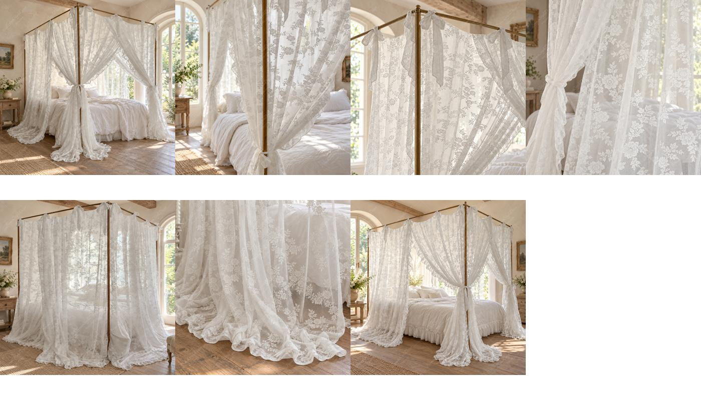

# Van-019：用户认可的床幔七图视觉基准

2026-09-21：用户认可花纹比例修正后的这一套效果，指定为后续床幔图片模板和店铺色调基准。保留自然白、法式乡村生活感和七张分工。图片为AI效果展示，不是织纹、材料或尺寸的证明。

|编号|参考图|
|---|---|
|01|[整体主图](images/01-lifestyle-overall-pattern-v2.jpg)|
|02|[束起与垂坠](images/02-medium-drape-pattern-v2.jpg)|
|03|[顶部挂法](images/03-top-ties-pattern-v2.jpg)|
|04|[花纹示意](images/04-pattern-detail-pattern-v2.jpg)|
|05|[垂放状态](images/05-lowered-panels-pattern-v2.jpg)|
|06|[下摆近景](images/06-hem-detail-pattern-v2.jpg)|
|07|[平视侧面整体](images/07-side-overall-pattern-v2.jpg)|

参考成品为2000×2000 sRGB JPG95、4:4:4，带用户指定Fren.png水印。无水印原稿、未采用版本与用户源图保留在本地产品目录，本次不删除也不覆盖。GitHub保存这套参考成品供跨设备调用。

下次制作请按[七图模板](../../listing-images/canopy-seven-image-template.md)执行，先看新产品原图，不从本参考反推花型、尺寸和材料。
